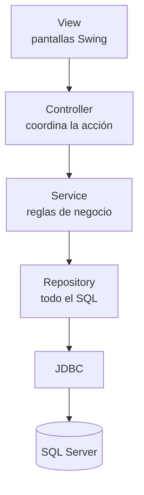
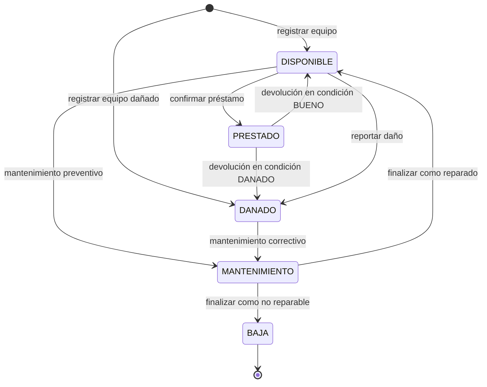
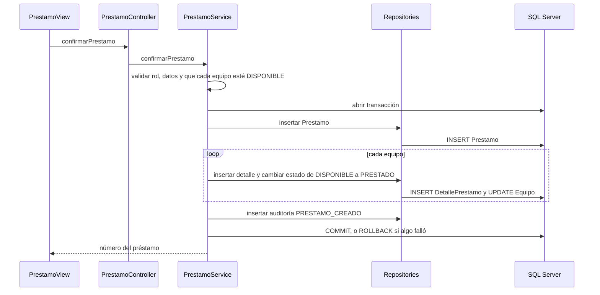
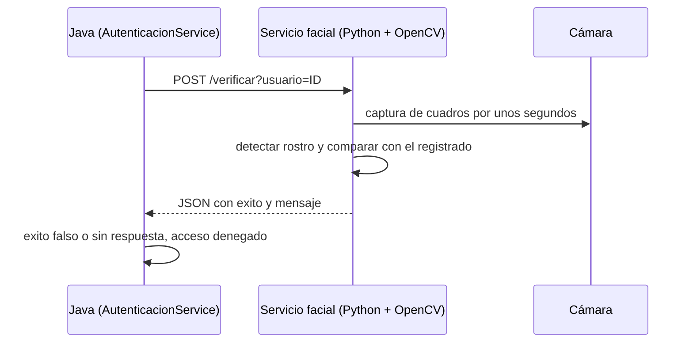

# Manual técnico - SIGELAB

Sistema de Gestión y Control de Laboratorios Universitarios. Curso 017 - Programación II, UMG.

Este manual explica cómo está construido el sistema: la arquitectura, dónde vive cada regla de negocio, cómo se
protege la consistencia de los datos y cómo se integran el QR y el reconocimiento facial.
Para instalar y ejecutar el sistema vea el [README](../README.md); para las tablas, el
[diccionario de datos](diccionario_datos.md) y el [modelo ER](modelo_er.md).

## 1. Tecnologías

| Componente | Tecnología |
|---|---|
| Lenguaje | Java (JDK 26) |
| Interfaz | Java Swing, formularios con el diseñador de IntelliJ IDEA |
| Base de datos | Microsoft SQL Server, acceso con JDBC (`mssql-jdbc`) |
| Dependencias | Maven |
| Códigos QR | ZXing (`core` y `javase`) |
| Reconocimiento facial | Servicio local en Python + OpenCV, consumido por HTTP |
| Control de versiones | Git |

## 2. Arquitectura por capas

| Capa | Qué hace | Qué NO hace |
|---|---|---|
| **View** | Captura datos, los muestra en tablas y combos, y muestra mensajes. | No tiene SQL ni reglas de negocio. |
| **Controller** | Convierte lo que escribe el usuario (por ejemplo, un texto a número) y llama al servicio. | No decide si una operación es válida. |
| **Service** | Valida, aplica las reglas RN-01 a RN-20, comprueba permisos por rol y abre las transacciones. | No escribe SQL. |
| **Repository** | Ejecuta el SQL con `PreparedStatement` y convierte filas en objetos. | No contiene reglas de negocio. |

Reglas que siguió todo el código:

- **Ninguna pantalla contiene SQL.** Toda consulta está en un `Repository`.
- **Las reglas importantes viven en el `Service`.** Ocultar o deshabilitar un botón es solo una ayuda visual: aunque alguien
  llamara al servicio sin pasar por la pantalla, la regla se aplicaría igual (RN-20).
- **Los errores técnicos no llegan al usuario.** La pantalla muestra siempre un mensaje comprensible (sección 8).

## 3. Estructura del código

Paquete base: `universidad.sigelab`

| Paquete | Contenido |
|---|---|
| `config` | `DatabaseConnection`: abre conexiones leyendo `config.properties`. |
| `enums` | `EstadoEquipo`, `EstadoRegistro`, `EstadoPrestamo`, `EstadoMantenimiento`, `CondicionDevolucion`, `TipoMantenimiento`, `ResultadoMantenimiento`, `RolUsuario`, `AccionAuditoria`, `FiltroPrestamos`. |
| `model` | Entidades: `Usuario`, `Rol`, `Laboratorio`, `TipoEquipo`, `Equipo`, `Prestamo`, `DetallePrestamo`, `Mantenimiento`, `Auditoria`. Y objetos de apoyo: `PrestamoResumen`, `DashboardResumen`, `ResultadoReporte`, `ResultadoFacial`. |
| `repository` | `UsuarioRepository`, `RolRepository`, `LaboratorioRepository`, `TipoEquipoRepository`, `EquipoRepository`, `PrestamoRepository`, `DevolucionRepository`, `MantenimientoRepository`, `AuditoriaRepository`, `DashboardRepository`, `ReporteRepository`. |
| `service` | `AutenticacionService`, `UsuarioService`, `LaboratorioService`, `TipoEquipoService`, `EquipoService`, `EstadoEquipoService`, `PrestamoService`, `DevolucionService`, `QrService`, `ReconocimientoFacialService`, `AuditoriaService`, `DashboardService`, `ReporteService`. |
| `controller` | Un controlador por servicio principal (por ejemplo `PrestamoController`). |
| `view` | `LoginView`, `PrincipalFrame`, `EquiposView`, `LaboratorioView`, `TipoEquipoView`, `UsuarioView`, `PrestamoView`, `DevolucionView`, `ReporteFrame`, `AuditoriaView`. |
| `util` | `SesionUsuario`, `Transaccion`, `HashUtil`, `TextoUtil`. |
| `exception` | `BusinessException`, `DataAccessException`, `ManejadorErrores`. |

## 4. Ciclo de vida del equipo

El estado de un equipo nunca se edita a mano: cambia solo como consecuencia de una operación de negocio.

- Un equipo `DANADO` **no puede volver a prestarse** hasta pasar por mantenimiento y quedar `DISPONIBLE`.
- Al registrar un equipo solo se puede elegir `DISPONIBLE` o `DANADO`. `PRESTADO` solo nace al confirmar un
  préstamo, y `MANTENIMIENTO` y `BAJA` solo salen del flujo de mantenimiento.
- `EstadoEquipo` incluye `puedePrestarse()` (solo `DISPONIBLE`) y `permiteTransicionA(...)`. La transición
  `DISPONIBLE → DANADO` (reportar un daño) la valida `EstadoEquipoService` directamente.

## 5. Dónde está cada regla de negocio

| Regla | Qué exige | Dónde se aplica |
|---|---|---|
| RN-01 | No iniciar sesión con usuario `INACTIVO` | `AutenticacionService.validarCredenciales` |
| RN-02 | El rostro debe aprobarse además de las credenciales | `AutenticacionService.verificarRostro`, `ReconocimientoFacialService` |
| RN-03 | Código de laboratorio único | `LaboratorioService.validarCodigoUnico` y `UNIQUE` en la tabla |
| RN-04 | Código de inventario único | `EquipoService.validarDuplicados` y `UNIQUE` en la tabla |
| RN-05 | Un préstamo tiene al menos un equipo | `PrestamoService.confirmarPrestamo` |
| RN-06 | El mismo equipo no se repite en un préstamo | `PrestamoService` y `UNIQUE (id_prestamo, id_equipo)` |
| RN-07, RN-08 | Solo un equipo `DISPONIBLE` se agrega a un préstamo | `PrestamoService.validarDisponible` (usa `EstadoEquipo.puedePrestarse`) |
| RN-09 | Al confirmar, cada equipo pasa a `PRESTADO` | `PrestamoService.confirmarPrestamo`, dentro de la transacción |
| RN-10 | Solo se devuelve un equipo pendiente de un préstamo activo | `DevolucionService.registrarDevolucion` |
| RN-11 | Un equipo no se devuelve dos veces | `DevolucionService` y `UNIQUE (id_detalle)` en `Devolucion` |
| RN-12, RN-13 | `BUENO` deja `DISPONIBLE`; `DANADO` deja `DANADO` | `DevolucionService.registrarDevolucion` |
| RN-14 | Un equipo en `MANTENIMIENTO` no se presta | `PrestamoService.validarDisponible` |
| RN-15 | Al finalizar mantenimiento, `DISPONIBLE` o `BAJA` | `EstadoEquipoService.finalizarMantenimiento` |
| RN-16 | El préstamo sigue activo mientras haya pendientes | `DevolucionService` (cuenta pendientes y finaliza el préstamo) |
| RN-17 | Vencido: fecha esperada pasada y equipos pendientes | Vista `vw_prestamos_vencidos`, `PrestamoResumen.estaVencido`, `ReporteRepository` |
| RN-18 | Las operaciones relevantes dejan rastro | `AuditoriaService` y `AuditoriaRepository`, dentro de las transacciones |
| RN-19 | El QR identifica, no modifica estados | `QrService.leerCodigo`, `EquipoService.buscarPorCodigo` |
| RN-20 | Las reglas no dependen de la interfaz | `SesionUsuario.exigirRol` o `exigirSesion` al inicio de las operaciones del `Service` (el login es la excepción: todavía no hay sesión) |

## 6. Flujos principales

### 6.1 Inicio de sesión (RN-01, RN-02)

`AutenticacionService.iniciarSesion` ejecuta tres pasos que la pantalla no puede saltarse:

1. **Credenciales:** busca el usuario, compara el hash SHA-256 de la contraseña y verifica que esté `ACTIVO`.
   Si algo falla se registra `LOGIN_FALLIDO` y el mensaje es el mismo exista o no el usuario.
2. **Rostro:** consulta el servicio facial. Si no reconoce el rostro, o el servicio no responde, el acceso se deniega y
   se registra `LOGIN_FALLIDO` con el motivo.
3. **Sesión:** guarda el usuario en `SesionUsuario` y registra `LOGIN_EXITOSO`.

La pantalla ejecuta este método en segundo plano (`SwingWorker`) porque la captura de la cámara tarda unos segundos.

### 6.2 Confirmar un préstamo (RN-05 a RN-09)

Antes de abrir la transacción, el servicio vuelve a consultar cada equipo en la base de datos: no se confía en lo que
muestra la pantalla.

### 6.3 Devolver equipos (RN-10 a RN-13, RN-16)

`DevolucionService.registrarDevolucion` recibe el préstamo, los equipos elegidos y la condición. Comprueba que el préstamo
esté `ACTIVO` y que cada equipo siga **pendiente** (una línea de `DetallePrestamo` sin fila en `Devolucion`). Después, en una
transacción: inserta cada devolución, cambia el equipo a `DISPONIBLE` o `DANADO`, audita `EQUIPO_DEVUELTO` y cuenta los
pendientes que quedan. Si no queda ninguno, el préstamo pasa a `FINALIZADO`. Una devolución parcial deja el préstamo `ACTIVO`.

### 6.4 Cambio de estado y mantenimiento (RN-15)

`EstadoEquipoService` ofrece tres operaciones, cada una en una transacción que cambia el estado, guarda el historial en
`Mantenimiento` y audita:

- `reportarDanio`: `DISPONIBLE → DANADO`.
- `enviarAMantenimiento`: `DISPONIBLE → MANTENIMIENTO` (solo preventivo) o `DANADO → MANTENIMIENTO` (solo correctivo).
- `finalizarMantenimiento`: `MANTENIMIENTO → DISPONIBLE` si queda reparado, o `→ BAJA` si no es reparable.

Un índice único filtrado impide dos mantenimientos abiertos para el mismo equipo.

## 7. Transacciones y consistencia

`util.Transaccion.ejecutar(...)` abre una conexión sin `autocommit`, ejecuta las operaciones y confirma con `commit`. Si
cualquier operación lanza una excepción, hace `rollback` y la vuelve a lanzar: no queda información a medias.

Los repositorios reciben la `Connection` de la transacción (por ejemplo `actualizarEstado(conexion, ...)`) para participar en ella.

Además, el cambio de estado de un equipo se escribe como `UPDATE ... WHERE estado = <estado esperado>`. Si dos usuarios
intentan prestar el mismo equipo a la vez, solo uno logra el cambio; el otro recibe un mensaje y su operación completa se
revierte.

La base de datos refuerza lo mismo con restricciones: `PRIMARY KEY`, `FOREIGN KEY`, `UNIQUE`, `NOT NULL` y `CHECK` (por ejemplo,
que `estado` solo admita los cinco valores válidos).

## 8. Manejo de errores

| Excepción | Cuándo se lanza | Qué ve el usuario |
|---|---|---|
| `BusinessException` | Se incumple una regla de negocio o una validación. | Su mensaje, ya redactado para el usuario, por ejemplo «Ya existe un equipo con el código CAM-001.» |
| `DataAccessException` | Falla JDBC o SQL. | Un mensaje general; el detalle técnico se registra en el log. |
| Otra excepción | Error inesperado. | «Ocurrió un error inesperado. Intente de nuevo.» |

`ManejadorErrores.mensajeParaUsuario(...)` hace esa conversión. Las pantallas siempre la usan; nunca muestran una `SQLException`.

## 9. Seguridad

- **Contraseñas:** se guardan como hash SHA-256 en hexadecimal (`HashUtil`) y el hash no sale del `Service` ni llega a las pantallas.
- **Inyección SQL:** todas las consultas usan `PreparedStatement` con parámetros.
- **Permisos:** `SesionUsuario.exigirRol(...)` y `exigirSesion()` se llaman al comienzo de las operaciones del `Service`.
- **Credenciales de la base de datos:** están en `config.properties`, que está en el `.gitignore`. El repositorio solo contiene `config.properties.example`.
- **Datos biométricos:** las fotos del rostro se guardan en `facial/rostros/` (fuera de Git) y el servicio escucha solo en `127.0.0.1`.
- **Mensajes de login:** son los mismos exista o no el usuario, para no revelar qué usuarios existen.

## 10. Integraciones

### 10.1 Código QR (`QrService`)

El QR contiene únicamente el **código de inventario** del equipo (por ejemplo `CAM-001`) y tiene una sola finalidad: identificarlo.

- **Generar:** `generarQrDeEquipo` comprueba que el equipo exista y escribe un PNG de 400×400 con ZXing.
- **Leer:** `leerCodigo` decodifica una imagen y devuelve el código. Luego el sistema **consulta la base de datos** con ese valor
  (`EquipoService.buscarPorCodigo`). Leer un QR nunca cambia un estado (RN-19). Un lector de códigos USB, que escribe el texto
  y pulsa Enter, funciona sin cambios.

### 10.2 Reconocimiento facial

- **Servicio** (`facial/servidor_facial.py`): escucha en `127.0.0.1:5001`. Usa el detector Haar de OpenCV para encontrar el
  rostro y `LBPHFaceRecognizer` para compararlo con las fotos registradas. Acepta si la mayoría de los cuadros capturados
  coinciden con el usuario, con una distancia menor al umbral `UMBRAL_CONFIANZA`.
- **Endpoints:** `GET /salud`, `GET /estado?usuario=ID`, `POST /registrar?usuario=ID` y `POST /verificar?usuario=ID`. Todos responden
  JSON con `exito` y `mensaje`.
- **Java** (`ReconocimientoFacialService`): usa `java.net.http.HttpClient`, interpreta la respuesta y deja que
  `AutenticacionService` decida. Si el servicio no responde, el acceso se deniega.
- **Registro del rostro:** solo lo hace el ADMIN, desde la pantalla *Usuarios*, o por consola con `python servidor_facial.py registrar <id>`.

## 11. Auditoría

`AuditoriaService` y `AuditoriaRepository` registran usuario, fecha y hora, acción, entidad, número de registro y descripción.
Las acciones definidas en `AccionAuditoria` son: `LOGIN_EXITOSO`, `LOGIN_FALLIDO`, `EQUIPO_REGISTRADO`, `EQUIPO_MODIFICADO`,
`EQUIPO_REPORTADO_DANADO`, `PRESTAMO_CREADO`, `EQUIPO_DEVUELTO`, `EQUIPO_ENVIADO_MANTENIMIENTO`, `MANTENIMIENTO_FINALIZADO`,
`USUARIO_REGISTRADO`, `USUARIO_MODIFICADO`, `USUARIO_DESACTIVADO` y `USUARIO_ACTIVADO`.

Las operaciones con varios pasos (préstamo, devolución, mantenimiento) escriben su auditoría **dentro de la misma
transacción**, así que si la operación se revierte, tampoco queda un registro falso.

## 12. Reportes y panel principal

- `vw_dashboard` calcula en una sola fila las cantidades del panel principal. La pantalla las recalcula al volver a la ventana principal.
- `ReporteRepository` contiene las consultas de los reportes: equipos por estado (`COUNT`, `GROUP BY`), por laboratorio y estado
  (`JOIN`), préstamos activos, finalizados y vencidos (`WHERE`, `HAVING`), préstamos entre fechas (`BETWEEN`) y los historiales de
  un equipo (`JOIN`, `LEFT JOIN`, `ORDER BY`).
- Un préstamo está vencido cuando su fecha esperada ya pasó y todavía tiene equipos pendientes; ese estado **no se guarda**, se calcula.

## 13. Limitaciones conocidas

- **Hash de contraseñas:** SHA-256 sin sal. Es suficiente para el alcance académico; en producción se usaría un algoritmo con sal y costo, como bcrypt o Argon2.
- **Reconocimiento facial:** LBPH es sencillo y sensible a la iluminación. No distingue una foto de una persona y no reconoce a varias personas a la vez; la guía deja ambas cosas fuera de alcance.
- **Lectura de QR:** se hace desde una imagen o con un lector USB; no hay lectura con cámara en vivo.
- **Sesión:** `SesionUsuario` es global, apropiada para una aplicación de escritorio de un solo usuario a la vez.
- **Compilación:** los formularios `.form` los compila IntelliJ IDEA, por lo que el proyecto se construye desde ese IDE.
- **Pruebas:** la validación de las reglas es manual, con los casos de prueba de la guía.

## 14. Cómo agregar un módulo nuevo

1. Tabla nueva en `sql/sigelab_bd.sql` (con sus `PRIMARY KEY`, `FOREIGN KEY`, `UNIQUE`, `NOT NULL` y `CHECK`).
2. Clase en `model` y enums para sus estados.
3. `Repository` con el SQL, usando `PreparedStatement`.
4. `Service` con las reglas, `SesionUsuario.exigirRol(...)` al inicio y, si cambia varias tablas, `Transaccion.ejecutar(...)`.
5. `Controller` delgado y `View` que solo captura y muestra, con los errores pasando por `ManejadorErrores`.
6. Una acción en `AccionAuditoria` si la operación es relevante.
