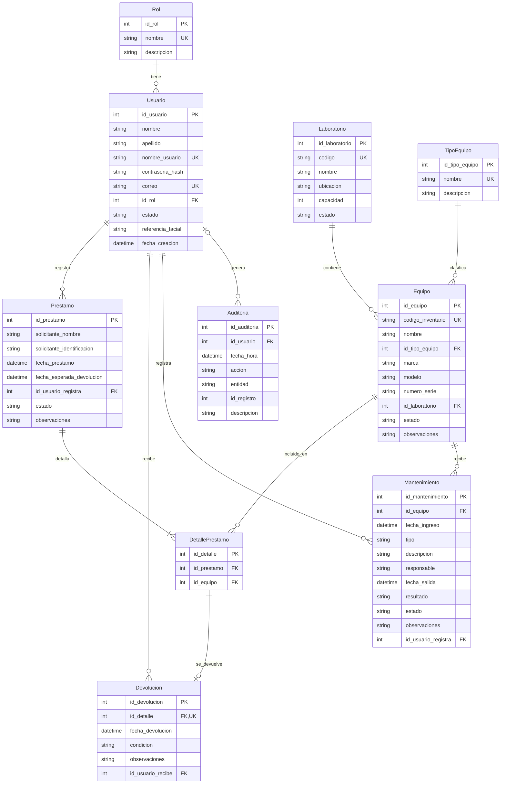

# Modelo entidad-relación - SIGELAB

Diagrama generado a partir de `sql/sigelab_bd.sql`: las tablas, columnas y llaves foráneas son las del script.
GitHub lo dibuja automáticamente. Si necesita una imagen, ábralo en GitHub y tome una captura, o genere el
diagrama desde DBeaver (clic derecho en la base `SIGELAB` → *View Diagram*).

## Cardinalidades

| Relación | Cardinalidad | Significado |
|---|---|---|
| Rol → Usuario | 1 a N | Un rol lo tienen muchos usuarios; cada usuario tiene un rol. |
| Laboratorio → Equipo | 1 a N | Un laboratorio contiene muchos equipos. |
| TipoEquipo → Equipo | 1 a N | Un tipo clasifica a muchos equipos. |
| Prestamo → DetallePrestamo | 1 a N (mínimo 1) | Un préstamo tiene al menos un equipo (RN-05). |
| Equipo → DetallePrestamo | 1 a N | Un equipo puede estar en muchos préstamos a lo largo del tiempo. |
| DetallePrestamo → Devolucion | 1 a 0..1 | Una línea se devuelve como máximo una vez (RN-11); sin devolución = pendiente. |
| Equipo → Mantenimiento | 1 a N | Un equipo acumula su historial de mantenimientos. |
| Usuario → Prestamo, Devolucion, Mantenimiento | 1 a N | Cada operación guarda qué usuario la realizó. |
| Usuario → Auditoria | 0..1 a N | Un registro de auditoría puede no tener usuario (login fallido de un usuario inexistente). |
